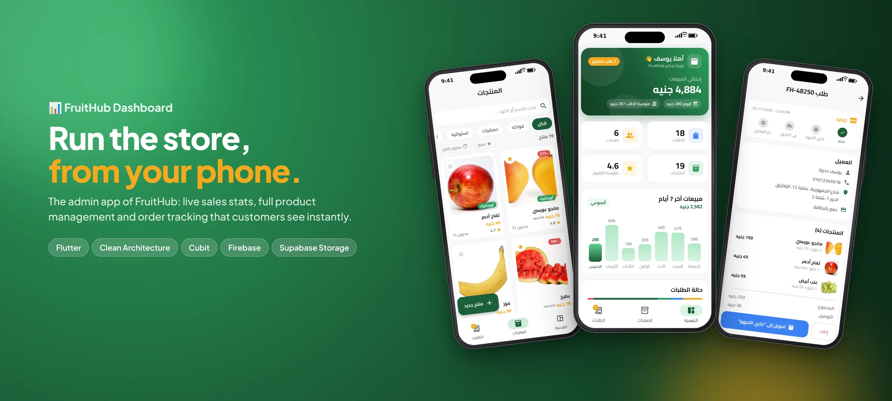
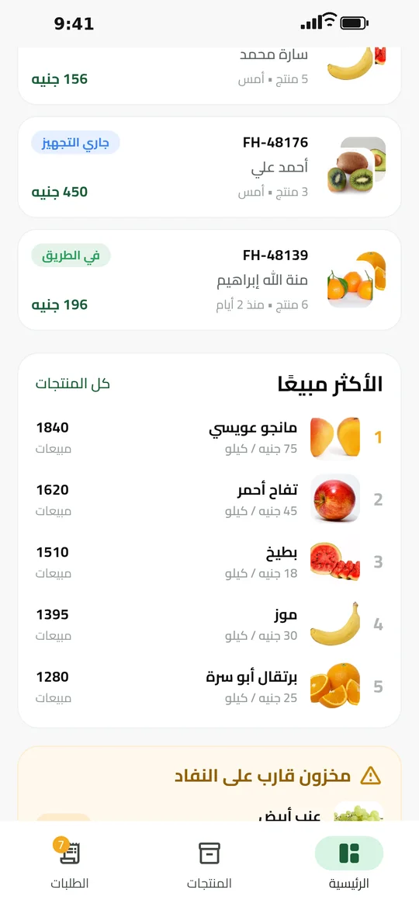
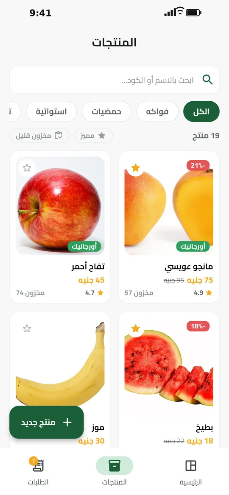
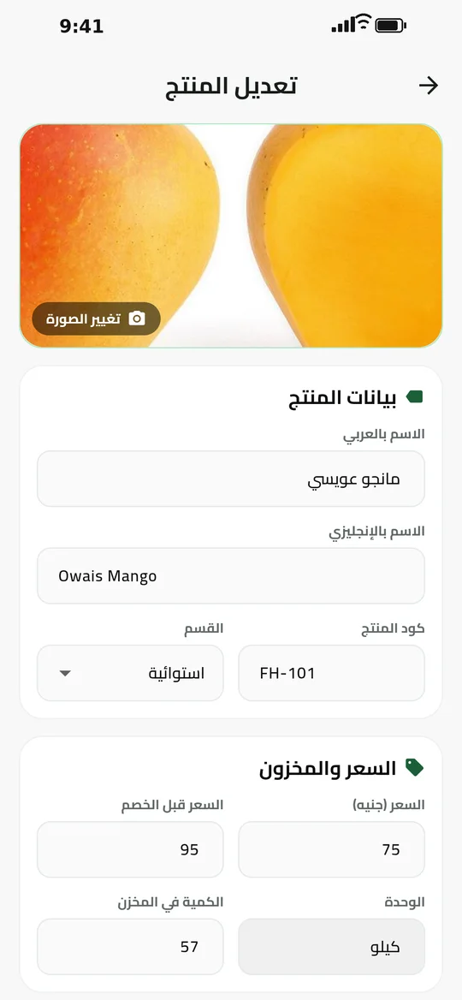
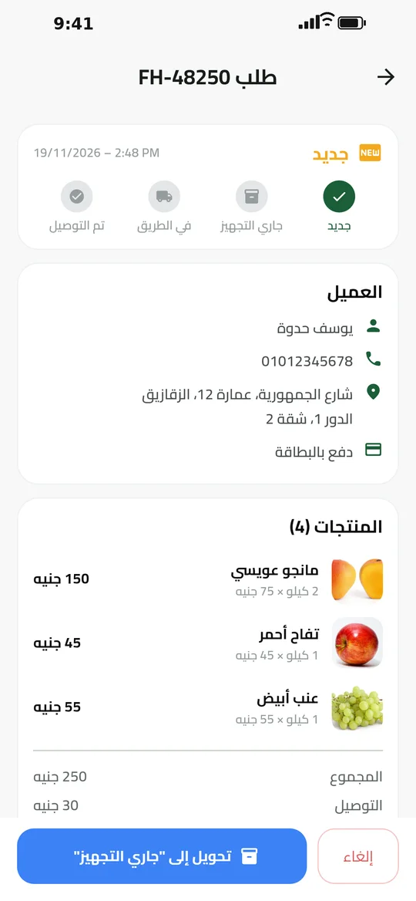
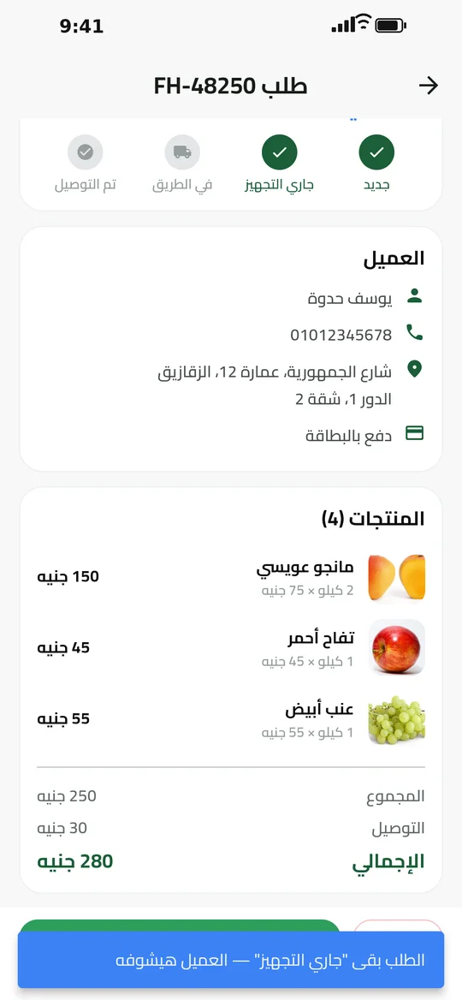

<h1 align="center">📊 FruitHub Dashboard</h1>

<p align="center">
  The admin app of <a href="https://github.com/youssef-hossam/fruit_hup_app"><b>FruitHub</b></a> — follow sales, manage the whole catalogue
  and move customer orders forward, all from your phone. It reads and writes the <b>same Firestore collections</b> as the customer app,
  so every change shows up there right away.
</p>

<p align="center">
  
  
  
  
  
</p>

<p align="center">
  
</p>

## 📱 Screens

| Overview | Best sellers & low stock | Products | Product details |
|:-:|:-:|:-:|:-:|
|  |  |  |  |

| Edit product | Orders | Order details | Status updated |
|:-:|:-:|:-:|:-:|
|  |  |  |  |

## ✨ Features

**📈 Overview**
- Total sales (cancelled orders excluded), today's sales and average order value.
- KPI cards: orders, customers, products and average rating.
- Animated bar chart of the last 7 days and a stacked bar of orders per status.
- Latest orders, top 5 best sellers and a **low-stock alert** list.

**🍉 Products**
- Grid with search (Arabic / English name or code), category chips and *featured* / *low stock* filters.
- One-tap ⭐ to feature a product on the client's home screen (optimistic update with rollback).
- Product page: price & discount, sales, rating, stock, expiry, calories, revenue and **customer reviews**.
- **Add / edit** form with every field the client app reads — Arabic + English name and description, price,
  price before discount (validated), unit, category, stock, expiry, calories, organic & featured switches and a photo.
- Delete with confirmation.

**🧾 Orders**
- All orders with status tabs and live counters; open orders badge on the bottom bar.
- Order page: customer, address, payment method, items, totals and a status timeline.
- Move an order *New → Preparing → On the way → Delivered* or cancel it — the customer sees the new step in **My orders**.

## 🔗 How it works with the client app

```
FruitHub (customer app)            FruitHub Dashboard (this repo)
  products  ──────── read ───────►   add / edit / delete / feature
  orders    ◄────── status ───────   pending → preparing → onTheWay → delivered
            ──────── read ───────►   stats, charts, order details
```

Both apps share the `products` and `orders` collections of the same Firebase project and the same document shape.
Product photos are uploaded to **Supabase Storage** and the public URL is saved on the product.

## 🏗️ How it's built

```
lib/
├── core/
│   ├── entities/ models/      # Product, Order, Review + Firestore mapping
│   ├── repos/                 # ProductRepo, OrdersRepo, ImageRepo  (Either<Failure, T>)
│   ├── services/              # DatabaseService (Firestore), StorageService (Supabase), get_it
│   ├── demo/                  # in-memory data for demo mode
│   └── widgets/ utils/ helper_fun/
└── features/
    ├── main_layout/           # bottom navigation shell
    ├── dash_board/            # overview + DashboardStats (pure Dart, unit-tested)
    ├── products/              # ProductsCubit, list & details
    ├── add_product/           # AddProductCubit, add / edit form
    └── orders/                # OrdersCubit, list & details
```

- **Clean layers:** UI → Cubit → Repo → Service, wired with `get_it`; errors come back as `Either` (`dartz`).
- **One source of truth:** `ProductsCubit` and `OrdersCubit` live at the app root, so the overview, lists and
  details always agree after an edit.
- **Cross-platform image picking:** the form keeps the image **bytes** (not `dart:io` `File`), so it works on mobile and web.
- Bundled **Cairo** font, Arabic RTL layout.

## 🚀 Run it

```bash
flutter pub get

# Real backend (Firebase + Supabase)
flutter run

# Demo mode — no backend needed, runs on sample data (used for the screenshots)
flutter run -d chrome --dart-define=DEMO=true

flutter test
```

---

<p align="center">Made with 💚 by <a href="https://github.com/youssef-hossam">Youssef Hadwa</a></p>
